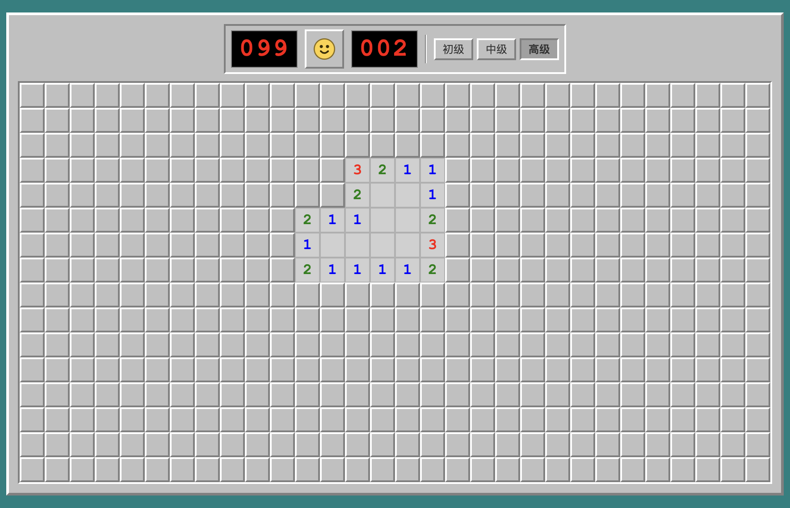
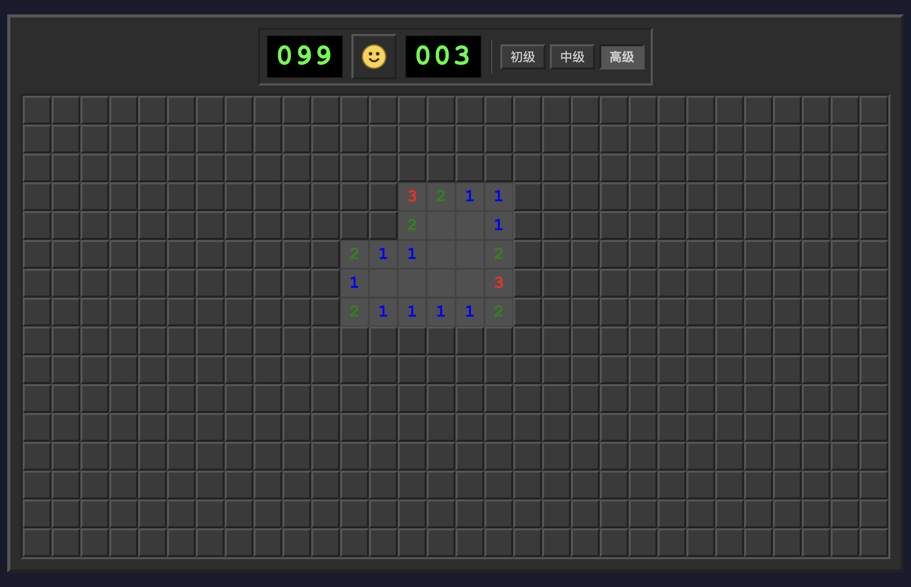

# 扫雷 🎯

**中文** | [English](README.md)

经典 Windows XP 风格扫雷游戏：macOS · Windows · Linux 跨平台桌面版，外加面向 960×640 横屏
安卓掌机 **攻氪 KPA**（Konkr KPA）的原生移植版。

- [功能](#功能) · [截图](#截图) · [快速开始](#快速开始)
- [操作说明](#桌面版操作说明) · [安卓版](#安卓版攻氪-kpa) · [项目结构](#项目结构)
- [发布与签名](#发布与签名) · [已知限制](#已知限制) · [许可证](#许可证)

---

## 功能

### 玩法

| 功能 | 说明 |
|---|---|
| 三档预设难度 | 初级 9×9/10 雷、中级 16×16/40 雷、高级 16×30/99 雷 |
| 自定义棋盘 | 行/列 9–50，雷数最多为格子总数的 85%（桌面与安卓一致） |
| 超大棋盘可读性 | 格子尺寸设有可读性下限；放不下时滚动浏览，而不是把格子压小 |
| 首点安全 | 3×3 无雷安全区，并保证首次点击空白格大面积展开 |
| 无猜模式 | 生成保证可纯逻辑推理通关的雷局；若在尝试次数/时间预算内未找到可解局，HUD 会明确提示本局可能需要猜（超大棋盘可能触发） |
| 无猜生成不阻塞 | 生成在后台线程执行，首点不冻结界面并显示「生成中」提示 |
| 和弦 | 桌面：双击、中键或左右键同时按在已翻开数字上；安卓：B 键 / 点按已翻开数字 |
| 标雷三态 | 右键（桌面）或标雷键（安卓）循环：旗 → 问号 → 取消 |
| 终局反馈 | 失败时错旗打叉、胜利时自动补旗，破纪录弹出「新纪录」横幅 |

### 体验优化

| 功能 | 说明 |
|---|---|
| 重开保护 | 对局进行中重开先弹确认框（默认停在「取消」） |
| 暂停 | 桌面：窗口失焦或打开对话框时自动暂停；安卓：切后台或打开对话框时自动暂停 |
| 键盘全操作 | 全部**游戏内**操作可用键盘完成，带键盘光标（支持斜向移动）；菜单/对话框入口通过鼠标或系统菜单键操作 |
| 键位自定义 | 游戏快捷键可重绑并持久化；安卓另有按键测试行，菜单键也可重绑（Back 为保留键） |
| 单实例运行 | 重复启动会聚焦已有窗口，避免双开互相覆盖统计（桌面） |
| 跟随系统深浅色 | 未手动选过主题时跟随系统深浅色 |
| 语言 | 中文 / 英文界面；默认跟随系统语言，可在应用内切换并持久化 |

### 统计

| 功能 | 说明 |
|---|---|
| 游戏统计 | 总局/胜/负、胜率、当前与最长连胜、各难度最快时间、总游戏时长 |
| 自定义棋盘分桶 | 自定义棋盘按棋盘尺寸（`行×列/雷数`）分别统计，不再全部混进同一个桶 |
| 3BV 效率 | 各桶最佳 3BV/s，以及最近 20 局胜利的效率曲线（含平均线） |
| 纪录公平性 | 暂停过的对局会记入历史，但不刷新最快时间/3BV-s 纪录；靠插旗获胜的对局仍计入最快时间，但不刷新 3BV/s 纪录 |
| 毫秒计时 | 纪录保留毫秒级时长；LED 显示与经典扫雷一样封顶 999 秒 |
| 单元测试 | 内置 `node:test`：引擎、求解器、布雷、统计、键位、移动、跨端一致性、UI 辅助（`npm test`） |

### 外观与平台

- **6 套主题**（浅色、深色、WinXP 银灰、Vista 蓝、macOS、macOS 深色），偏好持久化；
  未手动选择时跟随系统深浅色。
- **6 种运行时合成音效**（翻格、标旗、和弦成功/失败、爆炸、胜利），零外部音频文件；
  菜单可静音。
- **无障碍**：格子带语义标签、对话框可键盘操作、动画尊重系统「减少动态效果」偏好（桌面）。
- **窗口体验**（桌面）：记住窗口大小/位置、支持界面缩放、托盘常驻。
- **性能**：桌面使用脏格驱动的增量渲染；安卓把棋盘静态层缓存进可复用位图、只重绘变化格，
  大洪泛时跳过逐格动画。

---

## 截图

| 浅色主题 | 深色主题 |
|---|---|
|  |  |

---

## 快速开始

要求：**Node.js ≥ 22**（仓库提供 `.nvmrc`）与 npm。

```bash
npm install
npm start
```

## 测试与代码检查

```bash
npm test          # node:test 单元测试（引擎 / 求解器 / 布雷 / 统计 / 键位 / 移动 / 跨端一致性 / UI 辅助）
npm run lint      # ESLint（flat config，最小规则集）
npm run format:check
node scripts/check-version.mjs   # VERSION ↔ package.json ↔ CHANGELOG 一致性
```

## 打包（桌面版）

```bash
npm run dist:mac     # macOS .dmg（CI 上为 Apple Silicon）
npm run dist:win     # Windows x64 便携版 .exe
npm run dist:linux   # Linux x64 .AppImage
```

产物输出到 `dist/`，文件名为 ASCII（`minesweeper-<版本>-<系统>-<架构>-<扩展名>`），
产品显示名仍为「扫雷」。

> CI 在 `macos-latest`（Apple Silicon）、`windows-latest`（x64）、`ubuntu-latest`（x64）上构建，
> 因此 Linux 产物是 **x64**；Intel Mac 与 Linux arm64 不由 CI 构建。构建产物**未代码签名、未公证**，
> macOS Gatekeeper / Windows SmartScreen 首次打开可能提示风险（见[已知限制](#已知限制)）。

## 发布与下载

发布由 CI 自动上传到 GitHub Releases：

| 平台 | 格式 | 说明 |
|---|---|---|
| macOS（Apple Silicon） | `.dmg` | 在 `macos-latest` 构建；未签名/未公证 |
| Windows（x64） | `.exe` | 便携版，双击即运行；未签名 |
| Linux（x64） | `.AppImage` | `chmod +x` 后运行；在 `ubuntu-latest` 构建 |

每个 Release 还附带 `SHA256SUMS.txt`。桌面版发布使用 `desktop-v*` 标签，安卓版使用 `android-v*`
标签（见[发布与签名](#发布与签名)）。应用内「关于」页会显示当前运行版本号。

---

## 桌面版操作说明

| 输入 | 功能 |
|---|---|
| 鼠标左键 | 翻开格子；在已翻开数字上 = 和弦 |
| 鼠标右键 | 标雷三态：旗 → 问号 → 取消 |
| 双击 / 中键 / 左右键同时按 | 在已翻开数字上和弦 |
| 方向键 | 移动键盘光标（支持斜向，长按连续移动） |
| Space / Enter（默认） | 在光标处翻开或和弦 |
| F（默认） | 在光标处标雷 |
| F2（默认） | 新游戏（对局进行中需确认） |
| Esc | 关闭当前对话框 |

方向键、翻开/和弦、标雷、新游戏可在「游戏 → 键盘快捷键…」中重绑（对话框内显示当前绑定）。
F2 是键盘快捷键，不是原生菜单加速键。

---

## 安卓版（攻氪 KPA）

面向 960×640 横屏安卓掌机 **攻氪 KPA**（Konkr KPA：十字键 + ABXY）的原生移植版，代码在 `android/`：

- **原生 Kotlin**：自定义 View（Canvas）绘制，沉浸全屏，无浏览器层。
- **满屏布局**：整屏绘制为窗口面板色（不再在棋盘四周露出桌面底色）；棋盘按可用高度自适应放大
  （960×640 下初级格子由 48px 增至约 56px），并保留经典 2px 凹陷外框。
- **底栏状态区**：显示当前时间（跟随系统 12/24 小时制）与电量（图标 + 百分比；充电时绿色带闪电，
  ≤20% 显示红色）。
- **引擎移植**：`android/core` 纯 JVM 模块移植桌面版 `game.js` / `solver.js` / `movement.js` /
  `keybindings.js` / `stats.js` 逻辑，JUnit 单元测试覆盖。
- **手柄操作**：方向键移动（斜向 + 长按重复）、B=翻开/和弦、A=标雷（旗 → 问号 → 取消）、
  Start=新游戏、Select=菜单。
- **键位自定义**：菜单 → 键位设置，除保留键外任意键可重绑（含按键测试行）并持久化；Back 保留给关闭对话框。
- **无猜模式**：菜单开关，带自适应尝试次数/时间预算；生成在后台线程执行（界面不冻结，HUD 显示
  「正在生成无猜雷局…」）；若预算耗尽则沿用最后一次雷局并在 HUD 显示「⚠ 无解保护不可用」，不会静默降级。
- **3BV 效率统计与曲线**：各桶最佳 3BV/s；菜单「效率曲线」显示最近 20 局胜利折线（含平均线，
  左右键或屏幕箭头切换难度）。
- **防误触与终局反馈**：对局中重开先弹确认（默认停在「取消」）；失败时错旗打红叉；破纪录弹「新纪录」横幅。
- **触摸支持**：全部对话框支持触摸（菜单项点按执行；自定义雷区点行选中、点 ◀▶ 调整、有明确的
  确定/取消按钮；统计/关于点按关闭；曲线箭头切换难度；键位行点按进入录制）。底部难度按钮可直接
  点按（走同样的重开确认）；按下已翻开数字预览和弦范围；超大棋盘可拖动或跟随手柄光标滚动浏览。
- **状态恢复**：暂停或配置变化时保存当前对局，进程被系统回收后重建可续局，不丢棋盘。
- **语言**：安卓界面跟随系统语言（中文/英文字符串资源）。
- **无障碍**：TalkBack 会把游戏视图作为单个可操作控件暴露（翻开/标雷/新游戏/菜单四项动作），并在状态变化时播报（摘要级集成，非逐格虚拟节点）。
- **超大棋盘可读性**：格子边长下限 20px、数字占格子 60%、斜面宽度随格子缩放。
- **跟随系统深浅色**：未手动选过主题时跟随系统设置（含运行中切换），选过主题后固定。
- **版本号**：Gradle 从仓库根 `VERSION` 读取默认版本；CI 发布时由标签注入。
- **其余对齐桌面版**：三档难度 + 自定义雷区、6 套主题、6 种运行时合成音效、统计、自动暂停、
  首次点击安全、和弦失败 shake。

### 构建与安装（安卓版）

```bash
cd android
./gradlew :app:assembleDebug          # 产出 app/build/outputs/apk/debug/app-debug.apk
adb install -r app/build/outputs/apk/debug/app-debug.apk
```

> 故障排查：若本机项目路径含非 ASCII 字符（如中文目录）导致 Kotlin 编译报错或路径被转义为 `uXXXX`，
> 把 `android/` 复制到纯 ASCII 路径下构建即可（GitHub CI 不受影响）。

KPA 需先在系统设置中开启「开发者选项 → USB 调试」。调试包可直接侧载安装；正式发布用
`assembleRelease` 并配置签名（Release 已开启 R8 压缩混淆，签名后的 APK 约 0.3MB，Debug 包约 2.2MB）。

### 安卓版操作说明

| 按键 | 功能 |
|---|---|
| 方向键 | 移动光标（可斜向，长按连续移动） |
| B | 翻开格子；在已翻开数字格上按 = 和弦 |
| A | 标雷（插旗 → 问号 → 取消） |
| Start | 新游戏（对局进行中需二次确认） |
| Select | 菜单（新游戏 / 难度 / 自定义雷区 / 主题 / 静音 / 无猜 / 键位 / 统计 / 效率曲线 / 关于 / 退出） |
| Back | 关闭对话框 / 打开菜单 |

触摸（可选）：点按=翻开/和弦，长按=标雷，点表情=新游戏；超大棋盘可拖动浏览。全部对话框都支持触摸——
菜单项点按执行，自定义雷区点行选中、点 ◀▶ 调整数值、点「确定/取消」提交，统计/关于点按关闭，
效率曲线左右箭头切换难度，键位设置点行进入录制；点对话框外空白等价 Back 关闭。

---

## 项目结构

```
.
├── main.js / preload.js       Electron 主进程：窗口、菜单、worker 无猜生成、单实例、IPC、托盘与窗口状态
├── src/                       渲染进程（原生 JS + CSS3）
│   ├── game.js                游戏引擎（棋盘、洪泛、3BV、终局判定），无 DOM 依赖
│   ├── generator.js           布雷（普通 / 无猜）——可注入随机源与时钟
│   ├── solver.js              单点 / 子集 / 全局规则求解器（无猜保证）
│   ├── stats.js               统计 + 按桶分片历史（localStorage 可注入）
│   ├── keybindings.js         键位绑定（存储可注入）
│   ├── movement.js            键盘斜向移动合成
│   ├── i18n.js                中英文词典与 t()/setLanguage()（主进程共用）
│   ├── neighbors.js           邻域遍历公共辅助
│   ├── ui.js / app.js         渲染、对话框、计时器、键鼠流程
│   └── audio.js               Web Audio 合成音效
├── android/
│   ├── core/                  纯 JVM 引擎：GameEngine、Solver、StatsManager、KeyBindings、Synth…
│   └── app/                   原生安卓层：MainActivity + 自定义 View（Canvas）+ 资源
├── scripts/                   CI/维护脚本：check-version / sha256sums / release-notes / clean
├── test/                      桌面 node:test 单元测试
├── VERSION                    版本号唯一来源
└── docs/                      审查、设计与工程文档、截图
```

关键设计：

- 布雷与求解器是纯函数，渲染进程、主进程 worker 线程与 Node 测试共用；支持注入随机源/时钟，
  便于做确定性复现与测试。
- 桌面用 `markDirty`/`markAllDirty` 脏格驱动增量渲染；安卓用静态层位图缓存 + 脏区域重绘来对齐。
- 安卓 `core` 刻意不依赖 Android（只保留 `Storage` 接口），因此整套引擎可在纯 JVM JUnit 下测试。
- 用户数据全部本地存储：桌面 `localStorage`，安卓 `SharedPreferences`。

## 开发

- 工具链：Node.js ≥ 22（`.nvmrc`）、桌面构建用 Electron 45 + electron-builder 26、安卓 Java 17、
  内置 Gradle wrapper（AGP 8.5 / Kotlin 1.9）。
- 风格：ESLint flat config（`eslint.config.mjs`，最小规则集）、Prettier 覆盖 scripts/配置文件、
  `.editorconfig` 供编辑器使用；lint/format 门禁采用增量策略，避免一次改动大量历史文件。
- 测试：`npm test`（桌面）与 `cd android && ./gradlew :core:test`（安卓 core）。
- CI：每个 PR 跑桌面测试/lint/版本检查，以及安卓 `:core:test` + `:app:testDebugUnitTest` +
  `:app:lintDebug` + `assembleDebug`。
- 文档索引：[`docs/README.md`](docs/README.md)。历史审查保留在 `docs/` 下并带「历史快照」横幅；
  最新审查见 [`docs/review-2026-10-27/README.md`](docs/review-2026-10-27/README.md)。

## 发布与签名

**版本号唯一来源。** 仓库根目录的 `VERSION` 是唯一来源：`package.json.version`、`CHANGELOG.md`
首个数字版本、发布标签必须与之一致，CI 用 `scripts/check-version.mjs` 强制校验（本地也可运行）。

**标签语义。**

- 桌面版发布：`desktop-vX.Y.Z`（如 `desktop-v1.3.0`）→ `.github/workflows/build.yml`
- 安卓版发布：`android-vX.Y.Z`（如 `android-v1.3.0`）→ `.github/workflows/android.yml`
- 历史 `vX.Y.Z` 标签（`v1.0.0` … `v1.2.1`）**仅作存档冻结**，不再触发发布。

**桌面 CI。** 推送 `desktop-v*` 标签后先跑测试、lint 与版本校验，再构建 macOS/Windows/Linux 三平台
安装包；electron-builder 自动发布到 GitHub Releases，随后由独立 job 合并各平台校验和、生成
`SHA256SUMS.txt` 并从 CHANGELOG 最新段落写入发布说明。PR 与 `main` 推送只跑质量门，不打包。

**安卓 CI。** PR 与 `main` 推送跑测试、lint 和 Debug APK；推送 `android-v*` 标签构建签名正式版，
仓库需配置 secrets：`ANDROID_KEYSTORE_BASE64` / `ANDROID_KEYSTORE_PASSWORD` /
`ANDROID_KEY_ALIAS` / `ANDROID_KEY_PASSWORD`。

发布版本号由标签注入（`android-v1.2.3` → `versionName=1.2.3`、`versionCode=10203`）；
标签不是 `android-vX.Y.Z` 形式会直接中止发布，不再静默回落到默认版本号。APK 与
`SHA256SUMS-android.txt` 会附加到 GitHub Release。

**本地签名。**

```bash
cd android
keytool -genkeypair -v -keystore keystore/release.keystore -alias saolei \
  -keyalg RSA -keysize 2048 -validity 10000 \
  -storepass 你的密码 -keypass 你的密码 -dname "CN=Saolei, OU=Dev, O=wpiaopiao, C=CN"
# 然后创建 keystore/keystore.properties：
#   storeFile=keystore/release.keystore
#   storePassword=你的密码
#   keyAlias=saolei
#   keyPassword=你的密码
./gradlew :app:assembleRelease   # 产出签名 app-release.apk
```

`android/keystore/` 已被 gitignore，绝不能入库。**请把 keystore 与密码备份到仓库目录之外**
（例如 `~/saolei-secrets-backup/`，目录 `chmod 700`、文件 `chmod 600`）——丢失后将无法用同一密钥
续发版本。不要把备份放进 `dist/` 或仓库内任何目录：一次「把整个项目压缩分享」的误操作就会泄露
签名密钥与明文密码。CI 发布时把 keystore 的 Base64 与密码配置为仓库 secrets 即可全自动发布。

**发布前演练。** 每次发布前按 [发布前演练清单](docs/release-checklist.md) 走一遍（版本一致性、
本地构建与测试、fork 上标签演练、SHA-256 校验、未签名声明与回滚步骤），确保首次真实发布是演练过的流程。

## 已知限制

- **桌面安装包未签名、未公证**：macOS Gatekeeper 与 Windows SmartScreen 首次打开可能提示风险；
  暂无自动更新，需手动下载新版本。托盘图标已提供，但部分 Linux 桌面环境不支持托盘，此时应用会静默降级为无托盘运行。
- **暂无 Web/PWA 版**：桌面端目前只有 Electron 形态。
- **平台覆盖**：CI 只构建 macOS arm64、Windows x64、Linux x64；Intel Mac 与 Linux/Windows arm64
  不在构建矩阵内。
- **安卓端面向 KPA 掌机**：锁定横屏、按 960×640 设计，手机竖屏/平板/折叠屏尚未适配；
  `targetSdk` 为 34，且未准备 Android App Bundle、隐私政策与商店素材，暂不具备上架 Google Play 的条件。
- **无猜降级**：超大或高密度棋盘可能在上限内找不到可解局，此时 HUD 会明确提示、本局可能需要猜，
  不会静默降级。
- **无网络功能**：没有云同步、账号、排行榜或在线回放，所有数据仅保存在本机；目前 UI 也未提供
  导入/导出。
- **固定应用 ID**（`com.minesweeper.app` / `com.wpiaopiao.saolei`）：修改会改变用户数据目录、
  丢失本地统计，因此 1.3.0 刻意保持不变。
- **i18n 范围**：界面文案支持中文与英文；部分面向开发者的日志与内部注释仍为中文，未包含其他语言。
- `dist/` 已被 gitignore，可能存放你自己的安装包；`npm run clean` 会清理构建缓存与 `.DS_Store`
  （加 `--dist` 可一并删除本地安装包）。

## 许可证

[MIT](LICENSE) © 2026 w-PiaoPiao
